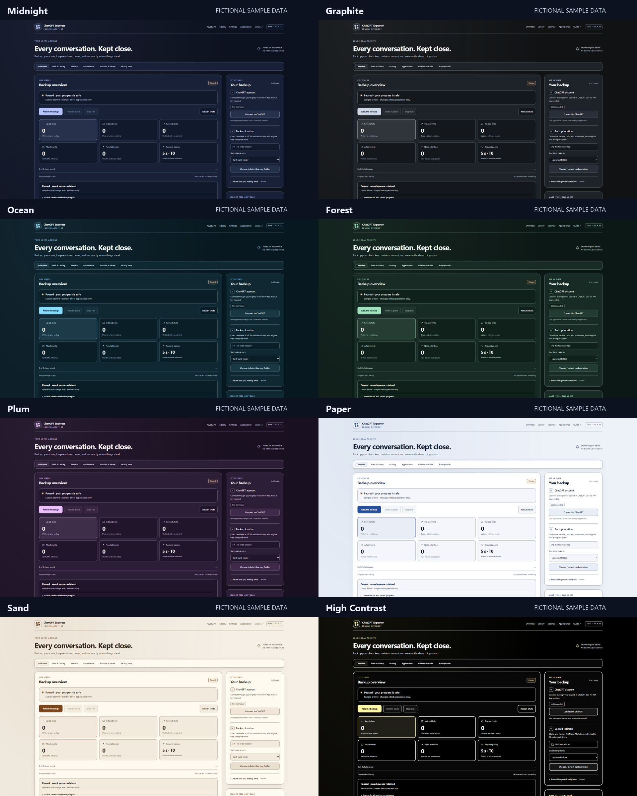

# Appearance and dashboard navigation

Exporter 2.4.21 · [Homepage](../README.md) · [Complete feature guide](FEATURES.md)

Select **Appearance** in the section bar or top navigation. Choose a palette; its preview shows the actual background, surface, accent and text colors. Native radio controls support Tab and arrow keys. Themes apply to the entire interface immediately, including files, logs and status indicators.

| Theme | Appearance |
| --- | --- |
| Midnight | Navy surfaces and lavender accents; the default |
| Graphite | Neutral charcoal and soft silver accents |
| Ocean | Deep blue and cyan |
| Forest | Dark green and mint |
| Plum | Purple and rose |
| Paper | Light surfaces and blue accents |
| Sand | Warm light surfaces and amber accents |
| High Contrast | Black/white surfaces, stronger borders and focus outlines |

**Layout density** offers Comfortable or Compact spacing. Compact reduces card and row spacing while keeping the same controls and data. Theme, density and disclosure preferences persist across refresh. The saved palette is restored before body paint when its local mirror is available; Chrome storage remains the primary preference store.

**Reset appearance** restores Midnight, Comfortable and collapsed optional disclosures. It only writes the appearance preference. Account jobs, queued chats, retry budgets, saved files, image preferences, folder grants, update cadence and Viewer catalogs remain in place. Appearance works while backup is running or held and in another dashboard that does not own the backup lock.

The sticky section bar links to Overview, Files & Library, Activity, Appearance, Account & folder and Backup tools. Navigation into a folded section opens its containing disclosure. **Need attention** opens the file-health/discovery details. Detailed queue and recent-progress information remains available under the work summary.

Optional settings, release controls and backup tools fold away to keep the overview compact. A collapsed release section still shows an available-update or failed-check notice. Opening and closing these sections does not start scans or downloads. Blank Add links input gives validation feedback before changing a paused queue.

The gallery uses real isolated Edge screenshots with fictional catalog data. It illustrates appearance, not actual remote downloads or backup speed. The source photos are captured at 1920 × 1080, and the combined gallery is 1920 pixels wide. No private account data or credentials are included. Historical GIFs elsewhere on the homepage retain their recorded versions.

[Validation and limits](VALIDATION.md) · [Every version](HISTORY.md)
